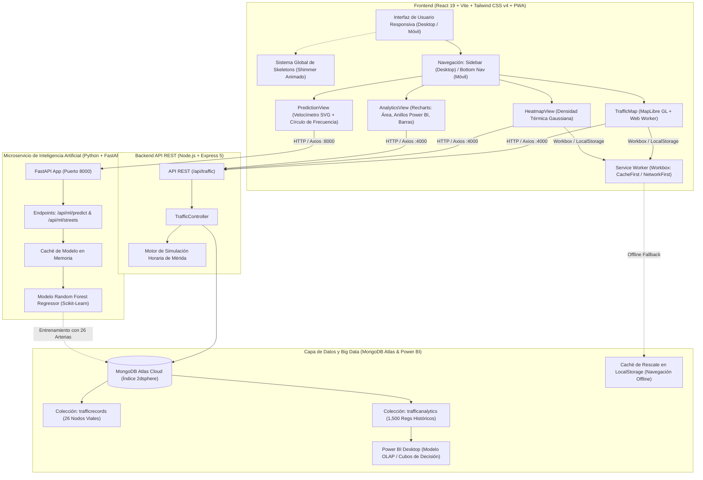

# 🚗 MovilMérida — Sistema Integral de Monitoreo, Análisis Geoespacial, Simulación Urbana y Machine Learning

> **Documento de Arquitectura de Software, Inteligencia Artificial y Justificación Técnica**  
> *Mérida, Yucatán, México — Proyecto de Ingeniería, Big Data Urbano y Machine Learning*

---

## 📌 1. Ficha Técnica y Resumen Ejecutivo

**MovilMérida** es una plataforma web progresiva (PWA) de monitoreo y modelado vial diseñada para la supervisión geoespacial, visualización cartográfica en tiempo real, análisis histórico y predicción inteligente del flujo vehicular en las principales arterias de Mérida y su Anillo Periférico.

El sistema integra:
1. **Cartografía Vectorial en Tiempo Real** acelerada por WebGL a 60 FPS mediante MapLibre GL.
2. **Capas de Densidad Térmica (Heatmap)** con interpolación Gaussiana de saturación vial.
3. **Simulador Urbano Basado en Reglas y Reproductor Histórico** de las últimas 3 horas.
4. **Dashboard de Inteligencia de Negocios (OLAP/BI)** con más de 1,500 registros históricos estructurados en MongoDB Atlas y sincronizados con modelos analíticos de Power BI.
5. **Microservicio de Machine Learning (IA)** con regresores de ensamble (*Random Forest*) para la estimación de velocidad y congestión en 26 arterias viales de la ciudad.
6. **Módulo Predictivo con Visualización Avanzada:** Velocímetro de aguja SVG animado y oscilograma de frecuencia vial dinámico adaptado a temas claro y oscuro.
7. **Arquitectura Offline Resiliente (PWA):** Service Worker con Workbox y almacenamiento local en `localStorage` con teselas vectoriales Carto Voyager en caché local.
8. **Sistema Global de Skeletons Metálicos:** Efecto shimmer de alta fidelidad que ofrece transiciones suaves de carga en todas las vistas.
9. **Diseño Adaptativo Híbrido:** Sidebar extensible de doble columna en escritorio y barra de navegación inferior ergonómica (*Bottom Nav*) con zonas seguras en dispositivos móviles (iPhone y Android).

---

## 🏗️ 2. Arquitectura General del Sistema



---

## ⚖️ 3. Justificación Tecnológica

### 3.1. Frontend

| Tecnología | Rol en el Proyecto | Justificación Técnica de Elección |
| :--- | :--- | :--- |
| **React 19** | Biblioteca de Interfaz de Usuario | Manejo declarativo del estado (`useState`, `useEffect`, `useRef`), renderizado concurrente y componentes desacoplados de alta reactividad. |
| **Vite** | Entorno de desarrollo y empaquetador | Carga instantánea vía ES Modules nativos, sustitución de módulos en caliente (HMR) y compilación optimizada para producción con Rollup. |
| **Tailwind CSS v4** | Framework de estilos utilitarios | Compilador de ultra-alto rendimiento en Rust (`@tailwindcss/vite`), eliminación de archivos de configuración engorrosos y soporte nativo para la variante `@custom-variant dark (&:where(.dark, .dark *))` para un cambio instantáneo de tema. |
| **MapLibre GL 6** | Motor de renderizado cartográfico | **Alternativa libre y superior a Google Maps:** Sin restricciones de cuota ni costos por tesela. Renderizado por hardware mediante **WebGL a 60 FPS** con soporte de **Web Workers aislados** (`maplibre-gl-worker.mjs`), garantizando fluidez total durante desplazamientos y zooms. |
| **Vite PWA & Workbox** | Service Worker y modo offline | Permite instalar la aplicación en móviles y PCs, interceptando peticiones de teselas vectoriales de Carto (`CacheFirst`) y APIs (`NetworkFirst`) para funcionamiento ininterrumpido sin internet. |
| **Recharts** | Biblioteca de analítica visual | Construida sobre SVG nativo con compatibilidad React 19. Ofrece transiciones fluidas de morphing en gráficas de área, tooltips flotantes personalizados y gráficos de dona tipo Power BI. |
| **Lucide React** | Iconografía vectorial | Paquete SVG ultraligero y modular con soporte de *tree-shaking*. |
| **Axios** | Cliente HTTP | Gestión con timeouts rápidos (4s) para conmutación inmediata a modo desconectado ante cortes de señal móvil. |

---

### 3.2. Microservicio de Machine Learning (Python)

| Tecnología | Rol en el Proyecto | Justificación Técnica de Elección |
| :--- | :--- | :--- |
| **Python 3.13** | Lenguaje para Inteligencia Artificial | Estándar de la industria para procesamiento numérico, ciencia de datos y entrenamiento de algoritmos de aprendizaje supervisado. |
| **FastAPI** | Framework de Microservicios | Rendimiento asíncrono equiparable a NodeJS/Go gracias a Starlette y Pydantic, validación automática de esquemas y documentación Swagger interactiva integrada en `/docs`. |
| **Scikit-Learn** | Biblioteca de Machine Learning | Provee la implementación de **RandomForestRegressor**, un ensamble de árboles de decisión altamente robusto frente al sobreajuste (*overfitting*) en series temporales no lineales. |
| **Pandas & NumPy** | Manipulación y estructuración de datos | Transformación matricial de registros históricos, vectorización de variables y preprocesamiento de series viales. |
| **PyMongo** | Conector nativo de MongoDB | Conexión directa a MongoDB Atlas para extraer los 26 nodos de la colección `trafficrecords` y los 1,500 registros de `trafficanalytics`. |
| **Uvicorn** | Servidor ASGI de producción | Servidor de eventos asíncronos ultrarrápido ejecutando en el puerto `8000`. |

---

### 3.3. Backend REST y Simulación Urbana (Node.js)

| Tecnología | Rol en el Proyecto | Justificación Técnica de Elección |
| :--- | :--- | :--- |
| **Node.js** | Entorno de ejecución de backend | Arquitectura dirigida por eventos y E/S no bloqueante, ideal para despachar coordenadas geográficas y métricas en tiempo real. |
| **Express 5** | Framework HTTP REST | Manejo desacoplado de rutas (`trafficRoutes.js`), controladores (`trafficController.js`) y middlewares de seguridad. |
| **Mongoose 9** | ODM (Object Data Modeling) | Validación estricta de esquemas GeoJSON Point (`location.coordinates: [lng, lat]`) y creación de índices geoespaciales `2dsphere`. |
| **CORS & Dotenv** | Seguridad y configuración | Regulación de solicitudes de origen cruzado entre frontend y backend, y almacenamiento seguro de cadenas de conexión. |

---

### 3.4. Base de Datos y Big Data Urbano

| Tecnología | Rol en el Proyecto | Justificación Técnica de Elección |
| :--- | :--- | :--- |
| **MongoDB Atlas** | Base de Datos NoSQL Distribuida | Capacidad de almacenamiento BSON elástico y soporte nativo para operadores geoespaciales (`$near`, `$geoWithin`) con índice `2dsphere`. |
| **Colección `trafficrecords`** | Catálogo de Nodos Viales Reales | Almacena las **26 arterias viales oficiales** de Mérida con sus coordenadas, nombres canónicos y clasificaciones viales. |
| **Colección `trafficanalytics`** | Repositorio Histórico para BI e IA | Contiene más de **1,500 registros estructurados** que simulan un mes de comportamiento vial (hora, día, velocidad promedio, demoras y nivel de saturación). |
| **Power BI Desktop** | Motor de Análisis OLAP | Extracción y modelado analítico mediante medidas DAX, generando la distribución porcentual exacta de congestión que reproduce la aplicación web. |

---

## 🗺️ 4. Módulos y Pantallas del Sistema

### 4.1. Mapa de Tramos Viales (`TrafficMap.jsx`)
- **Marcadores Inteligentes con Microinteracciones:** Círculos vectoriales con escala al cursor (`hover:scale-125`) y codificación cromática oficial:
  - 🟢 **Fluido / Bajo:** $\ge 55\text{ km/h}$
  - 🟡 **Moderado:** $40 - 54\text{ km/h}$
  - 🟠 **Alto:** $25 - 39\text{ km/h}$
  - 🔴 **Severo:** $< 25\text{ km/h}$
- **Popups Minimalistas de Apertura Exclusiva:** Estilo `.custom-traffic-popup` con tarjeta flotante limpia (`#e5e7eb`), evitando acumulación de cuadros en pantalla al cerrar automáticamente cualquier popup anterior al seleccionar uno nuevo.
- **Reloj Sincronizado en Vivo:** Muestra la hora local de Mérida junto con el estado global de la circulación.
- **Buscador y Filtrado Dinámico:** Búsqueda en vivo por nombre de arteria y filtros por chips para ocultar o exhibir niveles de saturación específicos.
- **Reproductor Histórico (Últimas 3 Horas):** Barra de reproducción con saltos temporales:
  - `Hace 2 horas`
  - `Hace 1 hora`
  - `Tiempo Real (Ahora)`
- **Resiliencia Offline:** Carga automática desde `localStorage` si no hay conexión a internet, acompañada de una etiqueta flotante de navegación fuera de línea (*Offline Badge*).

---

### 4.2. Mapa de Calor Geoespacial (`HeatmapView.jsx`)
- Interpolación de densidad térmica sobre el mapa de Mérida.
- Ponderación de pesos ($0.3$ a $1.0$) según la velocidad y congestión de cada tramo, permitiendo a planificadores urbanos detectar cuellos de botella críticos (Periférico Norte, Glorieta de la Paz, Av. Canek).
- Soporte offline con teselas en caché y datos locales.

---

### 4.3. Dashboard de Inteligencia de Negocios (`AnalyticsView.jsx`)
- **Tarjetas KPI Principales:**
  - *Velocidad Promedio Global:* $45.2\text{ km/h}$
  - *Demora Promedio en Picos:* $11.7\text{ min}$ ($+4.2\text{ min}$ en Centro Histórico)
  - *Volumen Estimado Analizado:* $677\text{k}$ vehículos en $1,500$ observaciones.
- **Gráfica de Área (Tendencia Horaria con Morphing):**
  - Curva esmeralda interactiva con selector temporal de **24 Horas**, **12 Horas** y **6 Horas**.
- **Gráfica de Anillos (Distribución de Congestión - Power BI):**
  - Réplica exacta del reporte de Power BI con `Recuento de _id por congestion_level`:
    - **Moderado:** 760 registros ($50.67\%$) — Azul `#0084ff`
    - **Alto:** 374 registros ($24.93\%$) — Naranja `#ea580c`
    - **Bajo:** 246 registros ($16.40\%$) — Azul marino `#1b365d`
    - **Severo:** 120 registros ($8.00\%$) — Violeta `#701a75`
    - Etiqueta central estilizada de **1.5 mil** con `z-index` adaptado para no obstruir los tooltips flotantes.
- **Gráfica de Barras Horizontales (Demoras por Sector):**
  - Comparativa de demoras estimadas: Centro Histórico ($16.5\text{ min}$), Periférico Norte ($13.8\text{ min}$), Periférico Poniente ($11.2\text{ min}$), Glorieta de la Paz ($10.4\text{ min}$), Altabrisa ($7.2\text{ min}$) y UTM/Sur ($5.0\text{ min}$).

---

### 4.4. Módulo de Predicción con Machine Learning (`PredictionView.jsx`)
- **Sincronización con las 26 Arterias Reales:** Consume el endpoint `GET /api/ml/streets`, desplegando la lista oficial de avenidas registradas en MongoDB `trafficrecords`.
- **Selectores de Escenario:**
  - *Vialidad:* Búsqueda y selección de la calle a evaluar.
  - *Día de la Semana:* Lunes a Domingo (preseleccionando automáticamente el día actual).
  - *Hora del Día:* Control deslizante interactivo de 00:00 a 23:00 hrs, con botones de acceso directo a horas pico de Mérida:
    - `08:00 hrs` — Entrada escolar y laboral.
    - `14:00 hrs` — Salida intermedia de escuelas y colegios.
    - `18:00 hrs` — Retorno de oficinas y saturación de Periférico.
- **Panel de Resultados de Alta Fidelidad Visual:**
  - **Encabezado Minimalista:** Resumen limpio con tipografía pulcra sin cajas grises invasivas.
  - **Velocímetro Vectorial SVG Animado (`SpeedometerGauge`):**
    - Semicírculo de 180° graduado con gradiente cromático.
    - Aguja indicadora con rotación calculada dinámicamente:
      $$\theta = \left(\frac{\min(\max(\text{velocidad}, 0), 100)}{100}\right) \times 180^\circ - 90^\circ$$
    - Indicador numérico de velocidad estimada en $\text{km/h}$.
  - **Círculo de Frecuencia Vial (`FrequencyCircle`):**
    - Anillo pulsante circular hueco de diseño estético, sin textos ni iconos centrales que obstruyan la composición.
    - Onda oscilográfica sinusoidal SVG con animación de pulso reactiva que incrementa su intensidad en niveles de congestión severos.
  - **Adaptabilidad a Modo Claro y Oscuro:** Transición automática entre fondos oscuros de cristal y paletas claras luminosas.
  - **Botón de Reevaluación:** Reinicia el formulario para realizar nuevas simulaciones predictivas.

---

## 🤖 5. Microservicio de Inteligencia Artificial y Modelo Predictivo

### 5.1. Algoritmo de Regresión: Random Forest
El servicio `python-ml-api` implementa un ensamble de árboles de decisión:
```python
RandomForestRegressor(
    n_estimators=50,
    random_state=42,
    min_samples_split=2
)
```
- **Ventajas de la elección:** Capacidad para capturar interacciones no lineales entre la hora del día, el día de la semana y la geometría de cada vialidad, previniendo el sobreajuste que presentan las regresiones polinomiales o redes neuronales con datos tabulares medianos.

### 5.2. Espacio de Características (Features)
El vector de entrada $X$ se compone de:
$$X = [\text{hora}, \text{calle\_encoded}, \text{día\_encoded}]$$
Donde:
- $\text{hora} \in [0, 23]$.
- $\text{calle\_encoded} \in [0, 25]$ (mapeo unívoco de las 26 arterias viales).
- $\text{día\_encoded} \in [0, 6]$ (Lunes = 0, ..., Domingo = 6).

### 5.3. Clasificación de Nivel de Congestión
A partir de la velocidad continua estimada $\hat{v}$, el sistema infiere el nivel categórico de congestión:
$$\text{Nivel}(\hat{v}) = \begin{cases}
\text{Bajo / Fluido} & \text{si } \hat{v} \ge 55\text{ km/h} \\
\text{Moderado} & \text{si } 40 \le \hat{v} < 55\text{ km/h} \\
\text{Alto} & \text{si } 25 \le \hat{v} < 40\text{ km/h} \\
\text{Severo} & \text{si } \hat{v} < 25\text{ km/h}
\end{cases}$$

### 5.4. Endpoints de la API de Machine Learning
- `GET /api/ml/streets`: Devuelve el arreglo ordenado de las 26 calles y avenidas activas en la ciudad.
- `POST /api/ml/predict`: Recibe el cuerpo JSON `{ "street_name": str, "hour": int, "day_of_week": str }` y retorna:
```json
{
  "street_name": "Avenida 86",
  "hour": 10,
  "day_of_week": "Jueves",
  "predicted_speed_kmh": 28.0,
  "congestion_level": "alto",
  "confidence_score": 0.91,
  "historical_samples_analyzed": 1500
}
```

---

## 📶 6. Arquitectura PWA y Resiliencia Offline

La aplicación está diseñada para operar como una Progressive Web App (PWA) de nivel industrial:

1. **Configuración de Workbox en `vite.config.js`:**
   - **Teselas Vectoriales de Carto Voyager:** Estrategia `CacheFirst` con expresión regular ampliada:
     ```javascript
     urlPattern: /^https:\/\/.*basemaps\.cartocdn\.com\/.*/i
     ```
     Almacena en caché estilos cartográficos, sprites, fuentes tipográficas y teselas MVT de `basemaps.cartocdn.com` y `tiles.basemaps.cartocdn.com`.
   - **Endpoints REST de Tráfico:** Estrategia `NetworkFirst` con tiempo límite de 4 segundos.
2. **Caché en `localStorage` (`merida_traffic_cache`):**
   - Inicialización perezosa (*lazy init*) en `TrafficMap.jsx` y `HeatmapView.jsx`.
   - Almacena automáticamente la última respuesta exitosa recibida del backend.
   - En caso de primer uso en modo desconectado, cuenta con una colección integrada de **19 nodos de rescate** con coordenadas reales de Mérida.
3. **Manejo Seguro de MapLibre GL sin Conexión:**
   - Temporizador de seguridad sobre eventos `styledata` y `isStyleLoaded` para garantizar que los marcadores y capas térmicas se rendericen aun cuando la resolución de fuentes remotas demore por falta de internet.
   - Indicador visual *Offline Badge Pill* en la parte superior que advierte al usuario del modo desconectado.

---

## ✨ 7. Sistema Global de Skeletons (Pantallas de Carga Shimmer)

Para evitar saltos visuales (*Layout Shifts*) y garantizar una experiencia fluida al cambiar de vista, se desarrolló un sistema modular de esqueletos de carga en `Skeletons.jsx`:

- **Animación Metálica `.skeleton-shimmer` en `index.css`:**
  Gradiente angular continuo con `@keyframes shimmerAnim` adaptado tanto para fondos claros como oscuros.
- **Componentes de Esqueleto Incluidos:**
  1. `MapSkeleton`: Simula el mapa con un radar de barrido giratorio, barras de búsqueda, botones de filtrado y tarjeta flotante de métricas.
  2. `HeatmapSkeleton`: Simula la gradación de calor con ondas pulsantes y panel de control.
  3. `AnalyticsSkeleton`: Reproduce la estructura exacta de las 3 tarjetas KPI superiores, el marco de área horaria, el anillo donut de Power BI y las barras de demoras.
  4. `PredictionSkeleton`: Estructura del formulario de selección de vialidad, día de la semana y control horario.
  5. `PredictionResultSkeleton`: Esqueleto de carga con simuladores de velocímetro y círculo de frecuencia mientras la IA calcula el resultado.

---

## 📱 8. Estrategia de Diseño Responsivo Móvil

1. **Escritorio y Tablets ($\ge \text{md}$ / $768\text{px}$):**
   - **Sidebar Modular de Doble Columna:** Columna fija de iconos de acceso rápido (`w-20`) y panel extensible lateral (`w-72`) con transición animada (`duration-300`).
   - El contenido principal ajusta su margen izquierdo dinámicamente (`md:pl-24` contraído y `md:pl-[392px]` expandido) sin solapar mapas ni gráficas.
2. **Dispositivos Móviles ($< \text{md}$):**
   - **Sidebar Oculta:** La barra lateral se oculta al 100% (`hidden md:flex`) para aprovechar toda la pantalla táctil.
   - **Barra de Navegación Inferior (Bottom Nav Bar):** Barra fija inferior con desenfoque de cristal (`backdrop-blur-lg`) con 5 botones accesibles:
     - 🗺️ **Tramos**
     - 🔥 **Calor**
     - 📊 **Analítica**
     - 🧠 **Predicción IA**
     - 🌓 **Tema (Claro / Oscuro)**
   - **Botón Flotante de Simulación Reposicionado:** Ubicado verticalmente a la par del botón de filtros en el margen inferior derecho (`bottom-24 right-4`), garantizando que **no sea tapado ni obstruya** la barra de navegación ni la zona segura (*safe area insets*) en iPhone y Android.
   - **Padding Inferior Seguro:** Clases `pb-28` en vistas analíticas y predictivas para permitir scroll completo sobre la barra inferior.

---

## 📂 9. Estructura de Directorios del Repositorio

```text
MovilMerida/
├── backend/                               # Servidor de API REST y Simulación
│   ├── .env                               # Variables de entorno (PORT, MONGODB_URI)
│   ├── index.js                           # Punto de entrada Express y conexión Atlas
│   ├── package.json                       # Dependencias Node.js (express, mongoose, cors, dotenv)
│   ├── seed.js                            # Seeder de las 26 vías de Mérida
│   ├── analyticsSeed.js                   # Seeder de los 1,500 registros para Power BI
│   └── src/
│       ├── controllers/
│       │   └── trafficController.js       # Simulación urbana, heatmap y métricas viales
│       ├── models/
│       │   ├── TrafficRecord.js           # Esquema GeoJSON Point con índice 2dsphere
│       │   └── TrafficAnalytics.js        # Esquema de Big Data histórico
│       └── routes/
│           └── trafficRoutes.js           # Endpoints de tráfico (/records, /heatmap, etc.)
│
├── python-ml-api/                         # Microservicio de Inteligencia Artificial
│   ├── main.py                            # API FastAPI, entrenamiento Random Forest y endpoints
│   ├── requirements.txt                   # Dependencias (fastapi, scikit-learn, pandas, pymongo)
│   └── venv/                              # Entorno virtual de Python
│
├── frontend/                              # Aplicación Web React PWA
│   ├── index.html                         # Punto de entrada HTML5
│   ├── package.json                       # Dependencias (react 19, vite, maplibre-gl, recharts, lucide)
│   ├── vite.config.js                     # Configuración de Vite, Tailwind v4 y Workbox PWA
│   └── src/
│       ├── main.jsx                       # Montaje de la aplicación React
│       ├── App.jsx                        # Layout general, Sidebar Desktop y Bottom Nav Móvil
│       ├── index.css                      # Tailwind v4, dark mode y animación shimmer
│       └── components/
│           ├── TrafficMap.jsx             # Mapa interactivo de tramos con MapLibre GL
│           ├── HeatmapView.jsx            # Capa de densidad térmica de congestión
│           ├── AnalyticsView.jsx          # Dashboard analítico con gráficas Power BI
│           ├── PredictionView.jsx         # Módulo de predicción IA con velocímetro SVG
│           └── Skeletons.jsx              # Esqueletos de carga shimmer para cada módulo
│
├── README.md                              # Ficha técnica y documentación del repositorio
└── DOCUMENTACION.md                       # Documento de arquitectura integral
```

---

## 🚀 10. Instrucciones de Instalación y Despliegue Local

### Prerrequisitos
- **Node.js** v18 o superior.
- **Python** 3.10 o superior (recomendado 3.12 o 3.13).
- Conexión a internet y cluster en **MongoDB Atlas**.

---

### Paso 1: Configurar el Backend Node.js (API REST)
```bash
cd backend
npm install
```
Asegúrate de que `backend/.env` contenga la cadena de conexión:
```env
PORT=4000
MONGODB_URI=mongodb+srv://<usuario>:<password>@cluster0.go4rq.mongodb.net/merida_traffic?retryWrites=true&w=majority
```
Poblar los datos de prueba iniciales:
```bash
node seed.js
node analyticsSeed.js
```
Iniciar el servidor:
```bash
npm run dev
# Servidor REST escuchando en http://localhost:4000
```

---

### Paso 2: Configurar el Microservicio de Machine Learning (Python FastAPI)
En una segunda terminal:
```bash
cd python-ml-api
# Crear y activar entorno virtual (Windows)
python -m venv venv
.\venv\Scripts\activate

# Instalar dependencias requeridas
pip install -r requirements.txt

# Iniciar servidor FastAPI con Uvicorn
uvicorn main:app --reload --port 8000
# Microservicio de IA disponible en http://localhost:8000
# Documentación Swagger interactiva en http://localhost:8000/docs
```

---

### Paso 3: Configurar el Frontend (React + Vite PWA)
En una tercera terminal:
```bash
cd frontend
npm install
npm run dev
# Aplicación web disponible en http://localhost:5173
```

Para generar la compilación de producción optimizada:
```bash
npm run build
```

---

## 📊 11. Resumen de Puertos y Servicios en Ejecución

| Servicio | Entorno | Puerto por Defecto | URL Local | Descripción |
| :--- | :--- | :--- | :--- | :--- |
| **Backend REST** | Node.js / Express | `4000` | `http://localhost:4000` | Simulación vial, nodos y analítica |
| **Microservicio ML** | Python / FastAPI | `8000` | `http://localhost:8000` | Predicción Random Forest y catálogo de calles |
| **Frontend Web PWA** | Vite / React 19 | `5173` | `http://localhost:5173` | Interfaz interactiva y mapas WebGL |

---

*Proyecto de Ingeniería de Software y Movilidad Inteligente — Mérida, Yucatán.*
