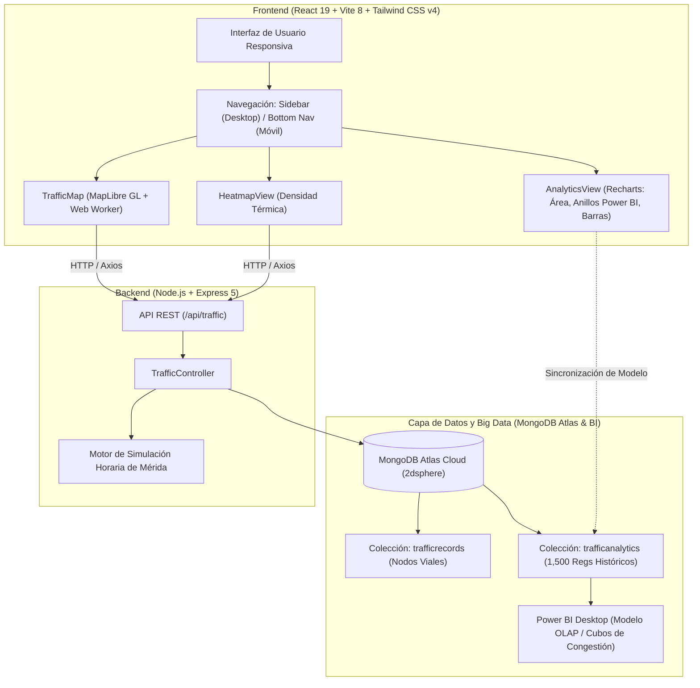

# 🚗 MovilMérida — Sistema Integral de Monitoreo, Análisis Geoespacial y Simulación de Tráfico Urbano

> **Documento de Arquitectura, Tecnologías y Justificación Técnica**  
> *Mérida, Yucatán, México — Proyecto de Ingeniería y Big Data Urbano*

---

## 📌 1. Ficha Técnica y Resumen Ejecutivo

**MovilMérida** es una plataforma web interactiva y progresiva (PWA) de monitoreo vial diseñada para el análisis geoespacial, visualización cartográfica en tiempo real y exploración histórica del tráfico en la ciudad de Mérida y su Anillo Periférico.

El sistema combina:
1. **Cartografía Vectorial en Tiempo Real** acelerada por WebGL.
2. **Capas de Densidad Térmica (Heatmap)** para identificación de puntos de saturación.
3. **Simulador de Tráfico Basado en Reglas Urbanísticas** y reproductor histórico de las últimas 3 horas.
4. **Dashboard de Inteligencia de Negocios (OLAP/BI)** alimentado por más de 1,500 registros estructurados en MongoDB Atlas y sincronizados con modelos analíticos de Power BI.
5. **Diseño Adaptativo Híbrido** (Sidebar de doble columna en escritorio y barra de navegación inferior nativa en dispositivos móviles).

---

## 🏗️ 2. Arquitectura General del Sistema



---

## ⚖️ 3. Justificación Tecnológica (¿Por qué cada tecnología?)

### 3.1. Frontend

| Tecnología | Rol en el Proyecto | Justificación Técnica de Elección |
| :--- | :--- | :--- |
| **React 19** | Biblioteca de Interfaz | Soporta el compilador moderno de React, manejo de estado reactivo mediante Hooks (`useState`, `useEffect`, `useRef`), renderizado concurrente y alta modularidad de componentes. |
| **Vite 8** | Entorno de desarrollo y empaquetador | Arranque instantáneo del servidor de desarrollo mediante ES Modules nativos, Hot Module Replacement (HMR) extremadamente rápido y builds de producción optimizados con Rollup/Rolldown. |
| **Tailwind CSS v4** | Framework de estilos utilitarios | Compilador ultra veloz basado en Rust (`@tailwindcss/vite`), eliminación de configuración compleja en JS, soporte nativo de variables CSS y regla `@custom-variant dark (&:where(.dark, .dark *))` para un cambio de tema claro/oscuro instantáneo y fluido. |
| **MapLibre GL 6** | Motor de mapas interactivos | **¿Por qué NO Google Maps API?** Google Maps impone límites estrictos de cuotas gratuitas, costos por llamada a la API y restricciones propietarias. <br/>**¿Por qué MapLibre GL sobre Leaflet estándar?** MapLibre renderiza vectores y estilos mediante **WebGL acelerado por hardware GPU**, permitiendo rotación, fluidez a 60 FPS y carga asíncrona de teselas con **Web Workers aislados** (`maplibre-gl-worker.mjs`), evitando congelar el hilo principal de la interfaz durante el paneo o zoom de la ciudad. |
| **Carto Voyager Basemaps** | Proveedor de Teselas Vectoriales | Estilo cartográfico claro, moderno, libre de marcas de agua invasivas y optimizado para resaltar los nodos cromáticos de tráfico (verde, amarillo, naranja y rojo). |
| **Recharts** | Biblioteca de visualización de datos | Construida sobre SVG nativo con compatibilidad React 19. Permite animaciones de transición fluidas (*morphing* entre 24h, 12h y 6h), contenedores auto-responsivos (`ResponsiveContainer`) y soporte total para **Custom Tooltips** personalizados con clases de Tailwind. |
| **Lucide React** | Iconografía vectorial | Biblioteca de iconos SVG ligeros, consistentes, con soporte de árbol de sacudida (*tree-shaking*) para no inflar el tamaño final del bundle. |
| **Axios** | Cliente HTTP | Interceptores automáticos, manejo robusto de transformaciones JSON y cancelación de peticiones asíncronas hacia el backend en Render. |

---

### 3.2. Backend

| Tecnología | Rol en el Proyecto | Justificación Técnica de Elección |
| :--- | :--- | :--- |
| **Node.js** | Entorno de ejecución | Modelo de E/S no bloqueante orientado a eventos (*Event-Driven Non-blocking I/O*), ideal para APIs REST de alto rendimiento que transmiten coordenadas y conjuntos de datos geoespaciales. |
| **Express 5** | Framework web REST | Versión moderna con soporte nativo de promesas asíncronas, enrutamiento desacoplado y arquitectura modular mediante controladores (`trafficController.js`) y rutas (`trafficRoutes.js`). |
| **Mongoose 9** | ODM (Object Data Modeling) | Define esquemas estrictos de validación de datos para coordenadas geográficas, velocidades y niveles de congestión, facilitando la creación de índices geoespaciales. |
| **CORS & Dotenv** | Middleware de seguridad y configuración | Control de acceso HTTP de origen cruzado para despliegues entre Render (Backend) y Vercel/Localhost (Frontend), y desacoplamiento de secretos de conexión mediante variables de entorno. |

---

### 3.3. Base de Datos y Big Data

| Tecnología | Rol en el Proyecto | Justificación Técnica de Elección |
| :--- | :--- | :--- |
| **MongoDB Atlas (Cloud)** | Base de Datos NoSQL Distribuida | Almacenamiento flexible en documentos BSON. Su característica fundamental para este proyecto es el **soporte geoespacial GeoJSON (`Point`, `[lng, lat]`)** y la creación del índice `2dsphere`: <br/>`trafficRecordSchema.index({ location: '2dsphere' });`<br/>Esto permite consultas de proximidad geográfica, delimitación de polígonos urbanos y consultas masivas en milisegundos. |
| **Colección `trafficrecords`** | Nodos viales de monitoreo | Contiene las coordenadas geográficas de los principales cruces viales de Mérida (Glorieta de la Paz, Periférico Norte, Periférico Sur/Kanasín, Av. Jacinto Canek, Av. Itzaes, etc.). |
| **Colección `trafficanalytics`** | Repositorio histórico de Big Data | Colección con más de **1,500 registros estructurados** que simula un mes de monitoreo continuo para alimentar cubos analíticos con campos clave: `hour`, `day_of_week`, `zone_name`, `sector`, `average_speed_kmh`, `congestion_level`, `vehicle_count_estimate` y `delay_minutes`. |
| **Power BI Desktop** | Motor OLAP y Business Intelligence | Procesamiento de cubos de decisión, cálculo de matrices de correlación horaria y generación del gráfico de distribución porcentual de congestión que luego se reproduce idénticamente en la aplicación web. |

---

## 🗺️ 4. Módulos y Pantallas del Sistema

### 4.1. Mapa de Tramos Viales (`TrafficMap.jsx`)
- **Nodos Inteligentes Vectoriales:** Marcadores esféricos con microinteracciones al pasar el cursor (`hover:scale-125`) y codificación cromática basada en estándares internacionales de vialidad:
  - 🟢 **Fluido / Bajo:** $\ge 55\text{ km/h}$
  - 🟡 **Moderado:** $40 - 54\text{ km/h}$
  - 🟠 **Alto:** $25 - 39\text{ km/h}$
  - 🔴 **Severo:** $< 25\text{ km/h}$
- **Popups Modernos con Control de Instancia Única:** 
  - Se eliminó el contenedor blanco cuadrado clásico de MapLibre mediante `.custom-traffic-popup` en CSS, renderizando una tarjeta gris minimalista (`#e5e7eb`) con imagen de vehículo, sector, velocidad y nivel.
  - **Lógica de apertura única:** Al hacer clic en un marcador, cualquier popup previo se cierra de forma instantánea para evitar saturar el mapa con múltiples tarjetas superpuestas.
- **Reloj Sincronizado en Vivo:** Badge superior que muestra la hora local de Mérida en formato `10:30 AM` junto con el nivel predominante de la ciudad.
- **Buscador y Filtros Rápidos:** Permite filtrar en tiempo real por nombre de calle o sector (ej. "Periférico", "Canek", "Centro") y conmutar los niveles de congestión visibles.
- **Modo Histórico (Evolución de las Últimas 3 Horas):** Barra de reproducción que permite comparar la evolución del tráfico entre:
  - `Hace 2 horas`
  - `Hace 1 hora`
  - `Hora Actual (Tiempo Real)`

### 4.2. Mapa de Calor Geoespacial (`HeatmapView.jsx`)
- Renderizado de densidad térmica sobre el plano urbano de Mérida.
- Emplea un gradiente suave que pondera la intensidad de saturación ($0.3$ a $1.0$), permitiendo a las autoridades de tránsito visualizar de un vistazo qué zonas (como la Glorieta de la Paz o los entronques del Periférico) presentan mayor concentración vehicular.

### 4.3. Dashboard Analítico (`AnalyticsView.jsx`)
- **Tarjetas KPI Principales:**
  - *Velocidad Promedio Global:* $45.2\text{ km/h}$
  - *Demora Promedio en Picos:* $11.7\text{ min}$ ($+4.2\text{ min}$ en Centro Histórico)
  - *Volumen Vehicular Analizado:* $677\text{k}$ registros estimados en $1,500$ nodos estructurados.
- **Gráfica 1 (Tendencia Horaria - Área con Degradado Esmeralda):**
  - Muestra la variación de la velocidad a lo largo de las horas del día.
  - **Filtro interactivo segmentado:** Permite al usuario alternar entre **24 Horas**, **12 Horas** y **6 Horas**, con una animación fluida de morphing en la curva.
- **Gráfica 2 (Distribución de Congestión - Anillos / Donut Chart):**
  - Réplica del informe de **Power BI** con el `Recuento de _id por congestion_level`:
    - **moderado:** 760 registros ($50.67\%$) — Azul `#0084ff`
    - **alto:** 374 registros ($24.93\%$) — Naranja `#ea580c`
    - **bajo:** 246 registros ($16.40\%$) — Azul marino `#1b365d`
    - **severo:** 120 registros ($8.00\%$) — Violeta `#701a75`
    - **Centro del anillo:** Etiqueta estilizada de **1.5 mil** Total.
    - **Z-Index adaptado:** El tooltip interactivo flota siempre por encima del texto central.
- **Gráfica 3 (Desempeño Vial por Sectores - Barras Horizontales):**
  - Muestra los minutos de demora estimada comparando sectores: Centro Histórico ($16.5\text{ min}$), Periférico Norte ($13.8\text{ min}$), Periférico Poniente ($11.2\text{ min}$), Glorieta de la Paz ($10.4\text{ min}$), Altabrisa ($7.2\text{ min}$) y UTM/Sur ($5.0\text{ min}$).

---

## 📱 5. Estrategia Responsiva y Adaptación Móvil (PWA)

El proyecto resuelve la experiencia de usuario aplicando un diseño responsivo diferenciado:

1. **Pantallas de Escritorio y Tablets ($\ge \text{md}$ / $768\text{px}$):**
   - **Sidebar Modular de Doble Columna:** Una barra de iconos fijos (`w-20`) y un panel extensible (`w-72`) con animaciones de apertura/cierre (`transition-all duration-300`).
   - El dashboard analítico ajusta su margen izquierdo dinámicamente (`md:pl-24` contraído y `md:pl-[392px]` expandido) para no ser tapado por la barra lateral.
2. **Dispositivos Móviles ($< \text{md}$):**
   - **Ocultamiento completo de la Sidebar:** Se oculta totalmente con `hidden md:flex`, liberando el 100% del ancho de la pantalla para la cartografía.
   - **Barra de Navegación Inferior (Bottom Nav Bar):** Barra fija en la parte inferior con desenfoque de cristal (`backdrop-blur-lg`) con 4 accesos rápidos: **Tramos**, **Calor**, **Analítica** y **Tema (Claro / Oscuro)**.
   - **Botón Flotante de Simulación:** Ubicado verticalmente sobre el botón de filtros en el mapa:
     - En tiempo real: muestra un **reloj** (`Clock`).
     - Al pulsarlo: activa el modo histórico y cambia a un icono de **antena** (`Antenna`) con animación de pulso para retornar a tiempo real.
   - **Espaciado inferior seguro:** El dashboard analítico añade `pb-24` en celulares para garantizar que al hacer scroll el usuario pueda ver todas las gráficas sin interferencia de la barra inferior.

---

## 🧠 6. Modelo Algorítmico de Simulación Vial de Mérida

El backend cuenta con la función `getSimulatedTrafficByHour(streetName, customHour)` en `trafficController.js`, la cual modela la realidad vial de Mérida:

1. **Zonas protegidas siempre fluidas:** Zonas con baja saturación estructural (ej. Villa Palmira, Inalámbrica, Parque Extremo) se mantienen fijas en nivel bajo ($65\text{ km/h}$).
2. **Franjas horarias de Mérida:**
   - **00:00 - 05:00 hrs:** Fluido ($65\text{ km/h}$, madrugada despejada).
   - **06:00 - 08:00 hrs:** Alto ($30\text{ km/h}$, entrada a escuelas y oficinas matutinas).
   - **09:00 - 11:00 hrs:** Severo ($15\text{ km/h}$, actividad comercial intensa y Centro Histórico).
   - **12:00 - 14:00 hrs:** Moderado ($45\text{ km/h}$, salida intermedia de escuelas).
   - **15:00 - 17:00 hrs:** Severo ($18\text{ km/h}$, hora pico vespertina y calor extremo).
   - **18:00 - 21:00 hrs:** Alto ($30 - 32\text{ km/h}$, retorno a hogares).
   - **22:00 - 23:00 hrs:** Moderado/Fluido ($50 - 58\text{ km/h}$).
3. **Ponderación por vía:** El Periférico y el Centro Histórico reciben penalizaciones de congestión durante horas pico, reduciendo drásticamente su velocidad simulada.

---

## 📂 7. Estructura de Directorios del Repositorio

```text
MovilMerida/
├── backend/
│   ├── .env                           # Variables de entorno (MONGODB_URI, PORT)
│   ├── index.js                       # Servidor Express principal y conexión Atlas
│   ├── package.json                   # Dependencias del servidor (express, mongoose, cors, dotenv)
│   ├── seed.js                        # Seeder de nodos viales geográficos
│   ├── analyticsSeed.js               # Generador de los 1,500 registros para Power BI
│   └── src/
│       ├── controllers/
│       │   └── trafficController.js   # Lógica de simulación, heatmap y métricas
│       ├── models/
│       │   ├── TrafficRecord.js       # Esquema GeoJSON Point con índice 2dsphere
│       │   └── TrafficAnalytics.js    # Esquema histórico para Big Data / OLAP
│       └── routes/
│           └── trafficRoutes.js       # Endpoints REST (/heatmap, /peakhours, etc.)
│
├── frontend/
│   ├── index.html                     # Punto de entrada HTML5
│   ├── package.json                   # Dependencias (react 19, maplibre-gl, recharts, lucide-react)
│   ├── vite.config.js                 # Configuración de Vite con Tailwind v4
│   └── src/
│       ├── main.jsx                   # Montaje de React DOM
│       ├── App.jsx                    # Layout principal, Sidebar Desktop y Bottom Nav Móvil
│       ├── index.css                  # Tailwind v4, dark variant y popups de MapLibre
│       ├── assets/                    # Recursos visuales (iconos, imágenes de tráfico)
│       └── components/
│           ├── TrafficMap.jsx         # Mapa de tramos vectoriales MapLibre GL
│           ├── HeatmapView.jsx        # Capa de densidad térmica de tráfico
│           └── AnalyticsView.jsx      # Dashboard con 3 gráficas (Área, Anillo Power BI, Barras)
│
└── DOCUMENTACION.md                   # Documentación técnica integral del sistema
```

---

## 🚀 8. Instrucciones de Instalación y Despliegue Local

### Prerrequisitos
- **Node.js** v18 o superior instalado.
- Cuenta o cluster en **MongoDB Atlas** con una base de datos creada.

### Paso 1: Configurar el Backend
```bash
cd backend
npm install
```
Crear un archivo `.env` en la carpeta `backend/` con las siguientes credenciales:
```env
PORT=4000
MONGODB_URI=mongodb+srv://<usuario>:<password>@cluster0.go4rq.mongodb.net/merida_traffic?retryWrites=true&w=majority
```
Poblar los datos de prueba (nodos viales y registros analíticos):
```bash
node seed.js
node analyticsSeed.js
```
Iniciar el servidor de desarrollo:
```bash
npm run dev
# Servidor escuchando en http://localhost:4000
```

### Paso 2: Configurar el Frontend
En otra terminal:
```bash
cd frontend
npm install
npm run dev
# Aplicación web disponible en http://localhost:5173
```

Para generar la compilación de producción optimizada:
```bash
npm run build
```

---

*Desarrollado para la evaluación y optimización del tráfico urbano en Mérida, Yucatán.*

